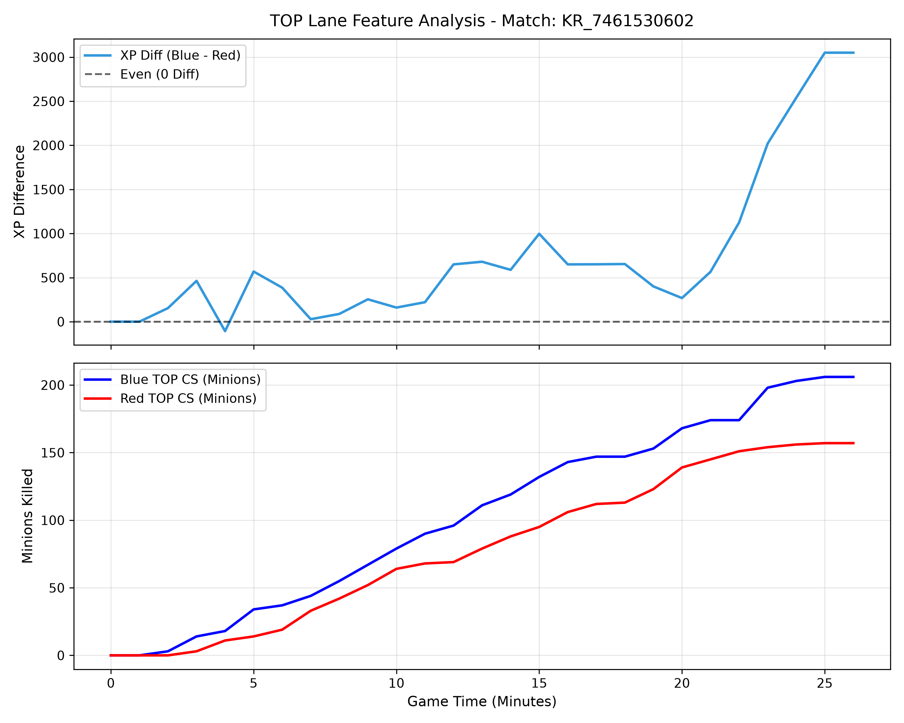
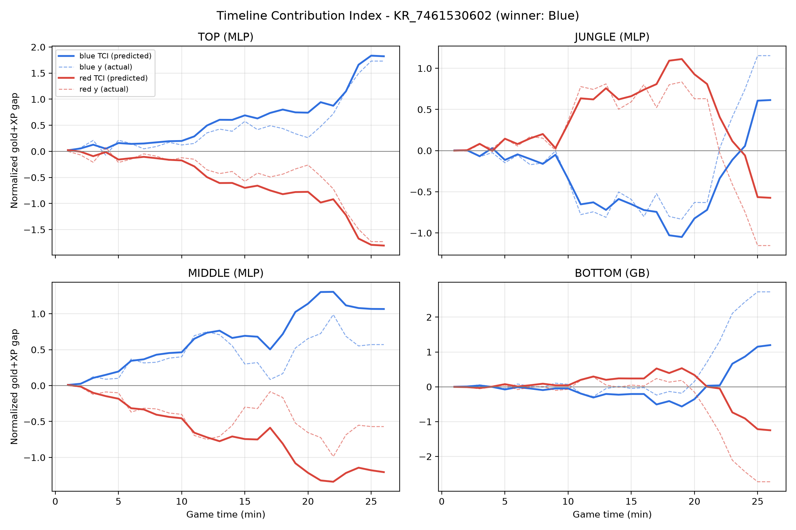
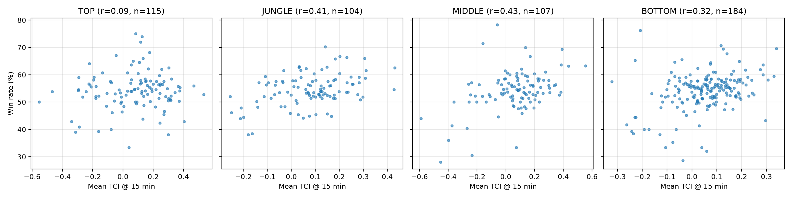

# 리그 오브 레전드 경기력 평가를 위한 설계 및 활용

## 1. 개요

---

리그 오브 레전드(League of Legends, 이하 LoL)는 2022 항저우 아시안게임 정식 종목으로 채택될 만큼 그 인기와 파급력이 이미 증명된 게임이다.
LoL을 플레이하는 가장 보편적인 방식은 랭크 게임이며, 그중 5대5 솔로 랭크 매치가 대표적이다.
솔로 랭크 매치는 최대 2명의 소환사가 함께 플레이할 수 있으며, 플레이의 일차적인 목적은 게임을 숙달하여 랭크를 올리는 데 있다.
솔로 랭크는 최고 수준의 실력을 갖춘 프로게이머나 스트리머도 플레이하는데, 이들은 일반적으로 팀 훈련을 보완하고 실력을 유지하기 위한 연습 수단으로 솔로 랭크를 활용하며, 챌린저 티어 플레이어일수록 하루 경기 수가 많고 꾸준히 플레이하는 경향을 보인다[[1]](https://doi.org/10.1080/10447318.2025.2527842). 이 과정에서 새로운 전략이나 챔피언을 시험해 보기도 한다.

따라서 솔로 랭크 매치에 대한 분석에서 단순한 승패 예측이나 팀워크 분석은 상대적으로 플레이 목적에 부합하지 않을 가능성이 높다.
반면 게임 플레이 과정상의 우열을 지표로 나타내는 것이 더 합리적인 분석 목적이 될 것이다.
이에 본 보고서에서는 특정 소환사 혹은 라인의 LoL 경기력을 **과정 지표**로 나타낼 수 있는 분석을 수행하고자 한다.

### 1.1 분석 데이터

LoL 개발사인 Riot Games는 자사의 개발자 포털([developer.riotgames.com](https://developer.riotgames.com))을 통해 게임 데이터를 무료로 제공하고 있다.
데이터는 API(Application Programming Interface) 방식으로 취득할 수 있으며, 경기 결과 요약인 **Match-V5** 데이터와 1분 단위 스냅샷 및 이벤트를 담은 **Timeline** 데이터로 구성된다.

본 연구의 분석 데이터는 2025년 1월 8일부터 2025년 4월 7일까지 한국 서버(KR) 챌린저 티어 300명이 플레이한 53,279건을 대상으로 한다.
여기서 챌린저 티어 300명은 2025년 4월 8일 기준이다(`puuid_challengers.txt`).
합리적인 분석을 위해 경기 시간이 20분(1,200초) 이상이면서 타임라인 데이터가 존재하는 경기만 사용하였으며, 중복을 제외한 최종 분석 대상은 **38,105건**이다.
전체 원본 데이터(`match_data.7z`, 약 2.6GB)는 용량 문제로 저장소에 포함하지 않으며, 저장소에는 구조 확인용 샘플 30경기(`match_0.json`, `timeline_0.json`)만 포함한다.

| 데이터 | 주요 내용 | 활용 |
|---|---|---|
| Match-V5 (`match_*.json`) | 경기 시간, 승패, 참가자별 포지션(`teamPosition`), 챔피언, K/D/A, 골드, 경험치 등 | 라인 구분, 승패 라벨 |
| Timeline (`timeline_*.json`) | 분 단위 `participantFrames`(골드, 경험치, CS, 데미지 등), `events`(킬, 포탑, 와드, 오브젝트 등) | 분 단위 피처·타겟 추출 |

### 1.2 경기력 평가를 위한 기본 방향

선행연구[[2]](https://www.kci.go.kr/kciportal/ci/sereArticleSearch/ciSereArtiView.kci?sereArticleSearchBean.artiId=ART003327764)에서는 동일한 데이터로 미드 라이너에 대한 경기력 평가를 분 단위 기준으로 실시하였다.
본 연구에서는 선행연구를 바탕으로 이를 4개의 라인(TOP, JUNGLE, MIDDLE, BOTTOM)으로 확장하여, 라인별 **타임라인 기여도 지수(Timeline Contribution Index, 이하 TCI)** 를 설계하고자 한다.
여기서 BOTTOM은 봇 듀오를 의미하며, 일반적으로 원거리 딜러(ADC)와 서포터(SPT, `teamPosition = UTILITY`)의 조합이므로 두 소환사의 지표를 합산하여 하나의 라인으로 다룬다.

라인별 TCI는 지도학습을 기반으로 모델링하며, 입력(라인별 중요 변수)과 출력(경기력 지표로 해석할 수 있는 결과값)을 설정한 뒤 적합한 모델을 선정한다.

$$
TCI_{LANE} (\vec{x},t ; \theta) , ~~~\text{where}~~LANE \in \{ TOP,~JUNGLE,~MIDDLE,~BOTTOM\}
$$

여기서 $\vec{x}$는 시점 $t$(분)까지의 라인별 과정 지표, $\theta$는 학습된 모델 파라미터이다.

---

## 2. 변수 설정

---

### 2.1 타겟 변수 설정

TCI를 지도학습 방식으로 모델링하기 위해서는 경기력을 대변할 수 있는 지표, 즉 지도학습의 출력에 해당하는 타겟 변수($y$)가 필요하다.
본 연구에서는 **분 단위 라인 맞상대와의 누적 골드 격차와 누적 경험치 격차를 각각 정규화한 뒤 평균한 값**을 타겟 변수로 설정한다.

$$
y_{LANE}(t) = \frac{1}{2}\left( \frac{\Delta Gold_{LANE}(t)}{\sigma^{Gold}_{LANE}} + \frac{\Delta XP_{LANE}(t)}{\sigma^{XP}_{LANE}} \right), \quad \Delta Gold = Gold_{me} - Gold_{opp},~~\Delta XP = XP_{me} - XP_{opp}
$$

여기서 $\sigma_{LANE}$은 해당 라인의 전체 샘플에 대한 격차의 표준편차이다.
격차는 블루 관점과 레드 관점이 서로 부호만 반대인 대칭 구조이므로 평균이 0이며, 따라서 표준편차로 나누는 것만으로 z-score 정규화가 된다.
본 연구의 정규화 기준값은 다음과 같다.

| 라인 | 골드 격차 $\sigma^{Gold}$ | 경험치 격차 $\sigma^{XP}$ |
|---|---|---|
| TOP | 1,680 | 1,531 |
| JUNGLE | 1,539 | 1,655 |
| MIDDLE | 1,476 | 1,419 |
| BOTTOM | 2,139 | 2,003 |

이렇게 설정한 이유는 다음과 같다.

- **골드**는 아이템 구매력, **경험치**는 레벨(스킬·기본 능력치)을 결정하므로 두 값을 함께 사용하면 해당 시점 챔피언의 성장 수준을 종합적으로 나타낼 수 있다.
- 두 변수는 단위와 분포가 다르므로 그대로 더하면 값의 범위가 큰 변수가 타겟을 지배하여 다른 변수의 정보가 손실된다. 이를 막기 위해 각 변수를 **정규화(z-score)한 뒤 결합**하여 두 변수가 동일한 비중으로 반영되도록 하였다.
- **격차**로 정의하면 경기 시간이 길어질수록 값이 커지는 누적값의 편향을 줄이고, 맞상대 대비 우열을 직접 해석할 수 있다(양수: 우세, 음수: 열세).
- 타겟의 타당성을 확인하기 위해 전체 38,105경기에서 팀 단위 격차의 부호만으로 최종 승패를 예측한 결과는 아래와 같다. 정규화한 (골드+경험치) 격차는 5분 59.0%에서 25분 83.2%까지 상승하며, 대부분의 시점에서 골드나 경험치 하나만 사용할 때보다 같거나 높은 정확도를 보였다. 특히 25분에는 골드 단독(81.9%)·경험치 단독(82.3%)보다 높아, 두 지표를 결합하는 것이 경기의 우열을 더 잘 반영함을 확인하였다.

| 타겟 후보 | 5분 | 10분 | 15분 | 20분 | 25분 |
|---|---|---|---|---|---|
| 골드 격차 | 58.9% | 64.4% | 71.5% | 78.7% | 81.9% |
| 경험치 격차 | 56.9% | 63.1% | 69.6% | 77.4% | 82.3% |
| **정규화 (골드+경험치) 격차** | **59.0%** | **64.6%** | **71.5%** | 78.6% | **83.2%** |

참고로 경기 종료 시점의 팀 총 골드(`goldEarned`) 우위는 샘플 30경기의 승패와 100%, 총 경험치(`champExperience`) 우위는 96.7% 일치하였다(`evaluate_y.py`).

### 2.2 라인별 피처 설정

라인별 피처($\vec{x}$)는 **LoL의 게임 구조와 라인별 역할에 대한 도메인 지식**을 근거로 설정하였다.
피처 선정은 다음 세 단계로 진행하였다.

#### (1) 피처 산출 방식 선택: 누적 격차로 통일

`data_process_sample.py`에서 예시로 제시한 네 가지 방식을 비교하여 하나로 통일하였다.

| 방식 | 예시 | 장점 | 단점 | 채택 |
|---|---|---|---|:-:|
| 누적 | 10분까지의 CS 수 | 계산이 단순함 | 경기 시간·챔피언에 따라 값의 크기가 달라 맞상대와 비교가 어려움 | |
| **격차** | 블루 CS − 레드 CS | 맞상대 대비 우열을 직접 표현, 부호로 해석 가능 | 라인 맞상대가 명확해야 함 | ✔ |
| 시점(delta) | 10~11분 사이 피해량 | 순간적인 변화 포착 | 값의 변동이 커서 노이즈가 많음 | |
| 이벤트 | 솔로킬 발생 | 결정적 장면 포착 | 발생 빈도가 낮아 대부분의 분에서 0 | |

본 연구는 타겟을 "맞상대와의 누적 성장 격차"로 정의하였으므로, 피처도 같은 관점인 **누적 격차(누적값의 블루−레드 차이)** 로 통일하였다. 이렇게 하면 입력과 출력이 같은 기준(시점 $t$까지 맞상대보다 얼마나 앞섰는가)을 가지게 되어 해석이 일관된다.
킬·포탑·와드 같은 이벤트 정보도 버리지 않고, 시점 $t$까지의 **발생 횟수를 누적한 뒤 격차**로 변환하여 같은 형식으로 사용하였다.

#### (2) 공통 원칙: 골드·경험치를 만드는 행동을 피처로

타겟인 골드와 경험치는 게임 안에서 정해진 경로로만 얻을 수 있다. 따라서 **"골드·경험치를 얻게 만드는 행동"** 이 곧 경기력을 나타내는 과정 지표라고 보고, 다음과 같이 피처를 도출하였다.

| 골드·경험치 획득 경로 | 대응 피처 |
|---|---|
| 미니언·정글 몬스터 처치 (가장 안정적인 수입원) | `csDiff`, `jgCsDiff` |
| 적 챔피언 처치·처치 관여 | `killDiff`, `assistDiff`, `soloKillDiff` |
| 죽지 않고 맵에 머무는 시간 (사망 중에는 CS·경험치를 얻지 못함) | `deathDiff` |
| 포탑 방패·포탑 파괴 | `plateDiff`, `towerDiff` |
| 드래곤·전령·유충·바론 등 오브젝트 | `objectiveDiff` |
| 위 행동을 가능하게 하는 교전 능력·시야 | `dmgToChampDiff`, `dmgTakenDiff`, `ccTimeDiff`, `wardDiff`, `wardKillDiff` |

반대로 **골드·경험치 자체와 경험치로부터 결정되는 레벨**은 타겟을 그대로 옮긴 값이므로, 피처에 넣으면 정보 누출(leakage)이 생겨 모델이 과정 지표를 학습하지 않게 된다. 실제로 샘플 30경기로 레벨 격차를 포함해 실험했을 때는 레벨 하나가 피처 중요도의 약 47~59%를 차지하여, 최종 피처에서 제외하였다.

#### (3) 라인별 역할에 따른 피처 선택

모든 피처를 모든 라인에 넣지 않고, 각 라인의 역할에 맞는 피처만 골라 라인별 TCI가 그 라인의 고유한 경기력을 반영하도록 하였다.

| 피처 | 설명 | 출처 | TOP | JUNGLE | MIDDLE | BOTTOM |
|---|---|---|:-:|:-:|:-:|:-:|
| `csDiff` | 미니언 처치 수 격차 | `minionsKilled` | ✔ | | ✔ | ✔ |
| `jgCsDiff` | 정글 몬스터 처치 수 격차 | `jungleMinionsKilled` | | ✔ | | |
| `dmgToChampDiff` | 챔피언에게 가한 피해량 격차 | `damageStats` | ✔ | | ✔ | ✔ |
| `dmgTakenDiff` | 받은 피해량 격차(탱킹) | `damageStats` | ✔ | | | |
| `ccTimeDiff` | 적에게 건 군중제어 시간 격차 | `timeEnemySpentControlled` | | ✔ | ✔ | |
| `killDiff` / `deathDiff` | 킬·데스 격차 | `CHAMPION_KILL` 이벤트 | ✔ | ✔ | ✔ | ✔ |
| `assistDiff` | 어시스트 격차 | `CHAMPION_KILL` 이벤트 | | ✔ | ✔ | ✔ |
| `soloKillDiff` | 어시스트 없는 킬 격차 | `CHAMPION_KILL` 이벤트 | ✔ | | ✔ | |
| `plateDiff` | 포탑 방패 파괴 격차 | `TURRET_PLATE_DESTROYED` | ✔ | | ✔ | ✔ |
| `towerDiff` | 포탑 파괴 관여 격차 | `BUILDING_KILL` | ✔ | | | |
| `wardDiff` / `wardKillDiff` | 와드 설치·제거 격차(시야) | `WARD_PLACED`, `WARD_KILL` | | ✔ | | ✔ |
| `objectiveDiff` | 드래곤·전령·유충·바론 처치 격차 | `ELITE_MONSTER_KILL` | | ✔ | | ✔ |
| `minute` | 경기 시간(분) | frame index | ✔ | ✔ | ✔ | ✔ |

**TOP — 고립된 1:1 라인**
- TOP은 맵 가장자리에 떨어져 있어 다른 라인의 도움을 받기 어렵고, 경기 대부분을 맞상대와 1:1로 보낸다. 따라서 **CS 관리(`csDiff`)** 와 **1:1 교전 결과(`soloKillDiff`, `killDiff`, `deathDiff`)** 가 핵심이며, 팀 단위 지표인 어시스트는 제외하였다.
- 라인전 우위는 포탑 압박으로 이어지므로 **포탑 방패(`plateDiff`)·포탑 파괴(`towerDiff`)** 를 포함하였다. 특히 TOP은 사이드 라인 운영으로 포탑을 미는 역할을 자주 맡는다.
- TOP에는 탱커·브루저 챔피언이 많아, 딜량(`dmgToChampDiff`)뿐 아니라 **받아낸 피해(`dmgTakenDiff`)** 도 기여로 보았다.

**JUNGLE — 맵 전체를 움직이는 역할**
- 정글러는 미니언 대신 정글 몬스터를 처치해 성장하므로 **`jgCsDiff`가 CS 지표를 대신**한다.
- 다른 라인에 개입하는 갱킹이 핵심 역할이므로 **킬·데스·어시스트(`killDiff`, `deathDiff`, `assistDiff`)** 와 갱킹 성공에 필요한 **군중제어(`ccTimeDiff`)** 를 포함하였다.
- 드래곤·전령·유충·바론 같은 **오브젝트 확보(`objectiveDiff`)** 는 정글러의 주된 책임이며, 오브젝트 주변 싸움에 필요한 **시야(`wardDiff`, `wardKillDiff`)** 도 포함하였다.
- 정글러는 맞상대와 같은 라인에 서지 않으므로 라인전 지표인 포탑 방패는 제외하였다.

**MIDDLE — 라인전과 로밍을 겸하는 역할**
- 기본은 1:1 라인전이므로 TOP과 같이 **`csDiff`, `soloKillDiff`, `plateDiff`** 를 포함하였다.
- 맵 중앙에 있어 양쪽 라인으로 이동(로밍)하기 쉬우므로, 다른 라인 교전 관여를 나타내는 **`assistDiff`** 를 추가하였다.
- 미드에는 마법사·암살자처럼 피해량과 군중제어가 강한 챔피언이 많아 **`dmgToChampDiff`, `ccTimeDiff`** 를 포함하였다.

**BOTTOM — 원거리 딜러(ADC) + 서포터의 2:2 라인**
- 두 명이 한 라인을 함께 쓰므로 두 소환사의 지표를 **합산**하였다. ADC의 성장은 **`csDiff`**, 팀 교전에서의 화력은 **`dmgToChampDiff`** 로 나타냈다.
- 2:2 교전은 두 명이 함께 싸우므로 **킬뿐 아니라 어시스트(`assistDiff`)** 가 중요하다.
- 서포터의 핵심 역할인 **시야 확보·제거(`wardDiff`, `wardKillDiff`)** 와, 바텀 라인 근처에서 벌어지는 **드래곤 싸움(`objectiveDiff`)** 을 포함하였다. 라인전 우위를 보여주는 **`plateDiff`** 도 포함하였다.

#### 피처 선정의 사후 확인

3.2절의 피처 중요도 결과는 위의 도메인 지식과 일관되었다. TOP과 MIDDLE에서는 `csDiff`가 가장 중요했고(라인 관리), JUNGLE에서는 `killDiff`와 `jgCsDiff`가 비슷한 비중(갱킹과 사냥), BOTTOM에서는 `killDiff`와 `assistDiff`가 상위(2:2 교전)로 나타났다. 반면 시야·군중제어 지표는 어느 라인에서도 상위 3위 안에 들지 않았는데, 이는 이들이 골드·경험치에 직접 반영되기보다 교전과 오브젝트를 거쳐 간접적으로 영향을 주기 때문으로 해석된다.

TOP 라인의 피처 추출 과정은 `data_process_sample.py`에 예시로 구현되어 있으며, 4개 라인 전체 피처 추출은 `tci_modeling.py`에 구현하였다.



*그림 1. 매치 KR_7461530602의 TOP 라인 경험치 격차(위)와 누적 CS 비교(아래), `testpile.py`로 생성*

---

## 3. 경기력 지표 모델링

---

### 3.1 모델 선정

입력(라인별 피처 $\vec{x}$와 시점 $t$)과 출력(정규화된 타겟 $y$)이 모두 연속형 수치이므로 회귀 문제로 정의하고, 간단한 모델부터 복잡한 모델까지 다음 4가지를 적용하여 비교하였다.

| 모델 | 구현 (scikit-learn) | 주요 설정 | 특징 |
|---|---|---|---|
| 선형회귀 (LR) | `LinearRegression` | - | 피처의 가중합으로 예측, 해석이 가장 쉬운 기준 모델 |
| 랜덤 포레스트 (RF) | `RandomForestRegressor` | 나무 100개, 최대 깊이 12 | 여러 결정 나무의 평균(배깅), 비선형 관계 학습 |
| 그래디언트 부스팅 (GB) | `HistGradientBoostingRegressor` | 반복 300회, 학습률 0.05, 잎 노드 31개 | 이전 나무의 잔차를 순차적으로 학습(부스팅) |
| 인공신경망 (MLP) | `MLPRegressor` | 은닉층 (64, 32), ReLU, Adam, 조기 종료 | 피처를 표준화한 뒤 다층 퍼셉트론으로 비선형 함수 근사 |

**손실 함수**는 예측값 $\hat{y}$와 타겟 $y$의 차이를 제곱해 평균한 평균제곱오차(MSE)로 설정하였으며, 모든 모델이 이를 최소화하도록 학습된다.

$$
L(\theta) = MSE = \frac{1}{N}\sum_{i=1}^{N}\big(y_i - \hat{y}_i\big)^2, \quad \hat{y}_i = TCI_{LANE}(\vec{x}_i, t_i; \theta)
$$

평가에는 MSE와 함께 RMSE($\sqrt{MSE}$, 타겟과 같은 단위), MAE(절대오차 평균), 결정계수 $R^2$(타겟 분산 중 모델이 설명하는 비율)를 사용하였다.

**검증 방법**: 같은 경기의 분 단위 샘플은 서로 강하게 연관되어 있으므로, 경기 단위로 학습/검증 데이터를 나누는 **5-fold GroupKFold** 교차검증을 사용하여 정보 누출을 방지하였다.
라인별 학습 샘플이 약 218만 개(경기 × 분 × 진영)에 달하므로, LR·GB는 전체 학습 데이터를 사용하고 학습 시간이 긴 RF·MLP는 fold마다 학습 데이터 중 30만 개를 무작위 추출하여 학습하였다. 평가는 모든 모델에 대해 검증 fold 전체로 수행하였다.

#### 최종 선정 모델 상세

3.2절의 비교 결과 TOP·JUNGLE·MIDDLE은 **MLP**, BOTTOM은 **GB**가 가장 낮은 MSE를 보였다.

**인공신경망 (MLP, Multi-Layer Perceptron)**
입력층(피처 9~10개) → 은닉층 1(64개 뉴런) → 은닉층 2(32개 뉴런) → 출력층(1개)으로 구성된다. 각 은닉층은 이전 층 출력의 가중합에 ReLU 활성화 함수 $\max(0, z)$를 적용한다.

$$
\vec{h}_1 = \text{ReLU}(W_1\vec{x} + \vec{b}_1),\quad \vec{h}_2 = \text{ReLU}(W_2\vec{h}_1 + \vec{b}_2),\quad \hat{y} = \vec{w}_3^{\top}\vec{h}_2 + b_3
$$

가중치 $\theta = \{W, b\}$는 MSE 손실의 기울기를 역전파(backpropagation)로 계산하고 Adam 옵티마이저(학습률 0.001, 배치 512)로 갱신한다. 검증용으로 떼어 둔 10% 데이터의 성능이 5 epoch 동안 개선되지 않으면 학습을 멈추는 조기 종료(early stopping)로 과적합을 방지하였다. 피처의 단위(CS 수, 피해량, 횟수 등)가 크게 다르므로 입력은 `StandardScaler`로 표준화하였다.

**그래디언트 부스팅 (GB)**
얕은 결정 나무를 순차적으로 더해 가되, 각 단계의 나무가 이전까지의 예측이 남긴 잔차(손실의 음의 기울기)를 학습한다.

$$
F_m(\vec{x}) = F_{m-1}(\vec{x}) + \eta \cdot h_m(\vec{x}), \quad h_m \approx -\frac{\partial L(y, F_{m-1}(\vec{x}))}{\partial F_{m-1}(\vec{x})}
$$

$\eta$는 학습률(0.05), $h_m$은 $m$번째 결정 나무이다. Histogram 기반 구현은 피처 값을 구간으로 나누어 분할점을 빠르게 탐색하므로 수백만 개 샘플에도 전체 데이터로 학습할 수 있다. 결정 나무 기반이므로 `minute`과 다른 피처 간의 상호작용(예: 같은 1킬이라도 5분과 25분의 가치가 다름)을 자동으로 학습하며, 순열 중요도(permutation importance)를 통해 피처별 기여도를 해석할 수 있다.

### 3.2 모델링 결과

전체 38,105경기(라인별 2,179,610개 샘플)를 대상으로 경기 단위 5-fold 교차검증한 결과는 다음과 같다(`tci_modeling.py`, 결과 원본은 `tci_results.md`). 타겟이 정규화되어 있으므로 오차 지표는 표준편차 단위로 해석한다(각 라인 $y$의 표준편차는 약 0.93~0.94).

| 라인 | 모델 | MSE | RMSE | MAE | $R^2$ |
|---|---|---|---|---|---|
| TOP | LR | 0.1236 | 0.3515 | 0.2266 | 0.8613 |
| | RF | 0.1281 | 0.3580 | 0.2276 | 0.8561 |
| | GB | 0.1206 | 0.3472 | 0.2199 | 0.8646 |
| | **MLP** | **0.1194** | **0.3456** | **0.2188** | **0.8659** |
| JUNGLE | LR | 0.1264 | 0.3556 | 0.2280 | 0.8576 |
| | RF | 0.1260 | 0.3550 | 0.2217 | 0.8580 |
| | GB | 0.1202 | 0.3467 | **0.2163** | 0.8646 |
| | **MLP** | **0.1196** | **0.3458** | 0.2165 | **0.8653** |
| MIDDLE | LR | 0.1617 | 0.4021 | 0.2601 | 0.8138 |
| | RF | 0.1633 | 0.4041 | 0.2522 | 0.8119 |
| | GB | 0.1524 | 0.3904 | 0.2420 | 0.8244 |
| | **MLP** | **0.1520** | **0.3899** | **0.2416** | **0.8249** |
| BOTTOM | LR | 0.1779 | 0.4218 | 0.2711 | 0.7941 |
| | RF | 0.1741 | 0.4173 | 0.2607 | 0.7985 |
| | **GB** | **0.1670** | **0.4087** | **0.2544** | **0.8067** |
| | MLP | 0.1685 | 0.4105 | 0.2550 | 0.8050 |

라인별 최종 모델과 주요 피처(GB 순열 중요도 기준 상위 3개)는 다음과 같다.

| 라인 | 최종 모델 | MSE | $R^2$ | 주요 피처(순열 중요도) |
|---|---|---|---|---|
| TOP | MLP | 0.1194 | 0.8659 | csDiff(0.44), killDiff(0.26), deathDiff(0.13) |
| JUNGLE | MLP | 0.1196 | 0.8653 | killDiff(0.48), jgCsDiff(0.42), assistDiff(0.06) |
| MIDDLE | MLP | 0.1520 | 0.8249 | csDiff(0.44), killDiff(0.40), assistDiff(0.07) |
| BOTTOM | GB | 0.1670 | 0.8067 | killDiff(0.50), assistDiff(0.23), csDiff(0.20) |

결과를 해석하면 다음과 같다.

- **설명력**: 모든 라인에서 최종 모델의 $R^2$가 0.81~0.87로, 설정한 과정 지표들이 정규화된 성장 격차 변동의 80% 이상을 설명한다. RMSE는 0.35~0.41로 타겟 표준편차의 약 37~44% 수준이며, MAE가 RMSE보다 상당히 작은 것은 대부분의 오차는 작고 대규모 교전·오브젝트 직후 등 일부 구간의 큰 오차가 RMSE를 키우기 때문으로 해석된다.
- **모델 간 비교**: 비선형 모델(GB, MLP)이 모든 라인에서 선형회귀보다 MSE가 약 3~6% 낮아 비선형·상호작용 효과가 존재함을 확인하였다. 다만 GB와 MLP의 차이는 1% 이내로 사실상 비슷한 성능이며, 개선 폭 자체가 크지 않다는 점은 누적 격차 피처와 타겟의 관계가 상당 부분 선형적임을 의미한다. RF는 학습 샘플을 제한한 영향으로 TOP·MIDDLE에서 선형회귀보다도 낮은 성능을 보였다.
- **라인별 특성**: TOP과 MIDDLE은 CS 격차의 중요도가 가장 높아 라인 관리가 성장 우위의 핵심이며, MIDDLE은 킬 격차의 비중(0.40)이 TOP(0.26)보다 커서 교전·로밍의 영향이 더 크다. JUNGLE은 킬 격차(0.48)와 정글 CS 격차(0.42)가 비슷한 비중으로, 사냥과 갱킹이 모두 중요하다.
- **BOTTOM**은 킬(0.50)과 어시스트(0.23)의 비중이 높아 2:2 교전 결과가 성장 우위를 좌우한다. 설명력($R^2$ 0.807)이 가장 낮은 것은 두 명의 지표를 합산하면서 서포터의 시야·보조 역할처럼 골드·경험치에 직접 드러나지 않는 기여가 섞이기 때문으로 보인다.

---

## 4. TCI 모델의 활용

학습된 모델의 예측값 $\hat{y} = TCI_{LANE}(\vec{x}, t; \theta)$는 "해당 시점까지의 과정 지표로 설명되는 라인의 성장 우위"를 의미한다.
선행연구를 참고하여 다음 세 가지 활용을 실제로 수행하였다(`tci_usage.py`).
과대평가를 막기 위해 모든 TCI 값은 3.2절과 같은 5-fold 교차검증에서 **해당 경기를 학습에 사용하지 않은 모델의 예측값(out-of-fold)** 만 사용하였다.

### 4.1 경기 단위 분석: 분 단위 TCI 곡선



*그림 2. 매치 KR_7461530602의 라인별 TCI(실선: 모델 예측, 점선: 실제 타겟). 파란색은 블루팀, 빨간색은 레드팀이며 블루팀이 승리하였다.*

| 라인 | 블루 TCI 10분 | 블루 TCI 15분 | 블루 TCI 20분 | 블루 TCI 최종 |
|---|---|---|---|---|
| TOP | +0.20 | +0.69 | +0.74 | +1.82 |
| JUNGLE | -0.34 | -0.65 | -0.82 | +0.61 |
| MIDDLE | +0.46 | +0.69 | +1.14 | +1.07 |
| BOTTOM | -0.05 | -0.21 | -0.35 | +1.20 |

- 이 경기에서 블루팀은 TOP과 MIDDLE에서 라인전 단계부터 꾸준히 우위를 쌓은 반면, JUNGLE은 10분 이후 큰 열세(-0.82)에 놓였고 BOTTOM도 20분까지 소폭 열세였다.
- 20분 이후 JUNGLE과 BOTTOM의 TCI가 모두 양수로 역전되었는데, 이는 TOP·MIDDLE에서 만든 우위가 중후반 교전과 오브젝트를 통해 팀 전체로 확산된 흐름으로 해석할 수 있다.
- 이처럼 TCI 곡선을 사용하면 경기 결과(승/패)만으로는 알 수 없는 **어느 라인이 언제 우위를 만들고 잃었는지**를 분 단위로 확인할 수 있다.

### 4.2 잔차 분석: 과정 지표와 실제 성장의 차이

그림 2의 MIDDLE에서 15 ~ 18분 구간을 보면 모델 예측(블루 TCI 약 +0.5~+0.7)에 비해 실제 성장 격차(점선)는 +0.1까지 떨어졌다.
즉 CS·킬 등 과정 지표상으로는 우위를 유지했지만, 같은 시기 실제 골드·경험치 격차는 따라가지 못한 것이다.
이처럼 잔차($y - \hat{y}$)가 큰 구간은 정의한 피처 외의 요인(팀원과의 자원 분배, 상대의 역습 등)이 작용한 구간으로 볼 수 있으며, 피처를 보완하거나 경기의 전환점을 찾는 근거로 활용할 수 있다.

### 4.3 소환사 평가: 챌린저 소환사별 평균 TCI

챌린저 300명(`puuid_challengers.txt`)이 각 라인에서 플레이한 경기의 **15분(라인전 종료 무렵) TCI**를 평균하고, 같은 라인에서 20경기 이상 플레이한 소환사를 대상으로 승률과 비교하였다. BOTTOM은 ADC와 서포터 모두에게 해당 라인의 TCI를 부여하였다.



*그림 3. 라인별 챌린저 소환사의 15분 평균 TCI(가로축)와 승률(세로축)*

| 라인 | 소환사 수 | 평균 TCI–승률 상관계수 $r$ |
|---|---|---|
| TOP | 115 | 0.086 |
| JUNGLE | 104 | 0.411 |
| MIDDLE | 107 | 0.432 |
| BOTTOM | 184 | 0.323 |

- JUNGLE($r$=0.41)과 MIDDLE($r$=0.43)은 15분 평균 TCI가 높은 소환사일수록 승률도 높은 뚜렷한 양의 상관을 보였다. 두 라인은 맵 중앙에서 다른 라인에 영향을 주기 쉬워, 초반 우위가 팀 승리로 이어지기 쉬운 것으로 해석된다.
- 반면 TOP은 상관이 거의 없었다($r$=0.09). TOP은 다른 라인과 떨어진 고립된 라인이라 라인전 우위가 팀 승리로 직결되는 정도가 상대적으로 작다는 해석이 가능하다.
- TCI는 승패와 무관하게 개인의 과정 경기력을 보여준다. 예를 들어 BOTTOM의 한 소환사(`GtlfC1FA`, 37경기)는 승률이 43.2%로 낮지만 평균 TCI는 라인 4위(+0.296)이며, **진 경기에서의 평균 TCI(+0.354)가 오히려 더 높았다**. 승률만으로는 낮게 평가될 수 있는 소환사의 개인 경기력을 TCI로 구분해 낼 수 있음을 보여준다.

라인별 평균 TCI 상위 소환사 목록은 `tci_usage_results.md`에 정리하였다(개인 식별을 피하기 위해 puuid 앞 8자리만 표기).

### 4.4 한계 및 향후 과제

- 상관 분석은 소환사 단위의 관계를 보여줄 뿐 인과관계를 의미하지 않으며, 같은 팀 동료의 경기력 등 다른 요인이 함께 반영되어 있다.
- BOTTOM은 ADC와 서포터의 지표를 합산하였으므로, 두 역할을 분리한 TCI를 설계하면 개인 평가가 더 정확해질 것이다.
- 향후 SHAP 등의 설명 기법을 결합하면 "이 경기에서는 CS 격차보다 데스 관리가 경기력 하락의 주원인"과 같은 경기별·소환사별 구체적인 피드백을 제공할 수 있다.

---

## 5. 소스코드 구성

| 파일 | 내용 |
|---|---|
| `access_match.py` | Match-V5 데이터 구조 확인 및 경기·플레이어 정보 출력 |
| `access_timeline.py` | Timeline 데이터 구조 확인 및 분 단위 지표 추출 예시 |
| `evaluate_y.py` | 타겟 변수 후보(골드, 경험치)의 승패 예측 정확도 확인 |
| `data_process_sample.py` | 매치 기본 정보 구성 및 TOP 라인 피처(누적·격차·시점·이벤트) 추출 예시 |
| `testpile.py` | `data_process_sample.py`에 TOP 라인 피처 시각화 기능 추가 |
| `tci_modeling.py` | 4개 라인 피처·타겟 추출 및 정규화, 타겟 검증, 4개 모델(LR·RF·GB·MLP) 학습 및 비교 (`tci_features.csv`, `tci_results.md` 생성) |
| `tci_usage.py` | 최종 모델의 교차검증 예측으로 TCI 계산, 예시 경기 TCI 곡선 및 챌린저 소환사별 평균 TCI 분석 (`tci_usage_results.md`, 그래프 생성) |
| `puuid_challengers.txt` | 2025년 4월 8일 기준 KR 챌린저 300명의 PUUID |

실행 환경: Python 3, `numpy`, `pandas`, `scikit-learn`, `matplotlib` (`requirements.txt`)

```bash
pip install -r requirements.txt
python tci_modeling.py   # 피처 추출 → tci_features.csv, 모델 비교 → tci_results.md
python tci_usage.py      # TCI 활용 분석 → tci_usage_results.md, 그래프
```

원본 데이터는 `match_data/match_data/` 폴더에 `match_N.json`, `timeline_N.json` 형태로 압축을 풀어 두어야 하며, `.gitignore`에 의해 데이터 파일은 저장소에 포함되지 않는다.

---

## 참고문헌

[1] Bennett, K. J. M., Poulus, D. R., & Novak, A. R. (2026). The Practice Behaviors of Expert League of Legends Players: An Exploratory Study. *International Journal of Human–Computer Interaction*, 42(4), 2279–2291. [https://doi.org/10.1080/10447318.2025.2527842](https://doi.org/10.1080/10447318.2025.2527842)

[2] KCI 등재 논문, [https://www.kci.go.kr/kciportal/ci/sereArticleSearch/ciSereArtiView.kci?sereArticleSearchBean.artiId=ART003327764](https://www.kci.go.kr/kciportal/ci/sereArticleSearch/ciSereArtiView.kci?sereArticleSearchBean.artiId=ART003327764)

[3] Riot Games Developer Portal, [https://developer.riotgames.com](https://developer.riotgames.com)
